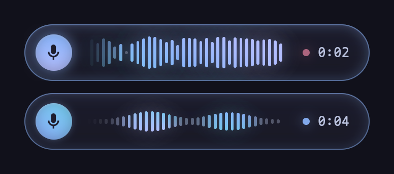

# voxtype-osd-gpui

A recording overlay for [voxtype](https://github.com/peteonrails/voxtype) (local push-to-talk
dictation), drawn with [GPUI](https://github.com/zed-industries/zed), Zed's GPU UI framework.
Catppuccin Mocha with a Blue accent. It shows the live microphone level while you talk, a travelling
wave while Whisper transcribes, and fades out when the text is typed.



It runs on macOS (a non-activating floating panel that never takes focus or clicks) and on Wayland
compositors with wlr-layer-shell (tested on niri). voxtype itself is used unmodified: its OSD
dispatcher runs `voxtype-osd-<frontend>` from its own directory, so this installs as
`voxtype-osd-native` next to `voxtype` and `[osd] frontend = "native"` selects it.

The overlay reads two things the daemon already publishes in its runtime directory
(`$XDG_RUNTIME_DIR/voxtype`, or `/tmp/voxtype` on macOS): the `state` file and `audio.sock`, which
streams 16-byte level frames at 100 Hz while recording.

## Let Claude Code do it

Paste this into Claude Code on the Mac:

```
Install voxtype dictation with the GPUI overlay on this Mac by following the "macOS install"
section of https://github.com/rudrabhoj/voxtype-osd-gpui/blob/master/README.md exactly.
Build from source, do not use the Homebrew voxtype cask or `voxtype setup app-bundle`.
Before step 7, stop and tell me exactly which permissions to grant and where; I click them.
Then verify with me as in step 8.
```

## macOS install

Tested on Apple Silicon. voxtype is built with Metal, so `small.en` transcribes a sentence in about
0.2-0.5 s.

1. **Prerequisites.** Xcode Command Line Tools (`xcode-select --install`), Rust through
   [rustup](https://rustup.rs), and from Homebrew:

   ```sh
   brew install cmake
   brew install --cask font-maple-mono-nf               # the overlay's font and mic glyph
   brew install --cask jackielii/tap/skhd-zig            # hotkey daemon
   ```

2. **voxtype**, built from source with Metal:

   ```sh
   git clone https://github.com/peteonrails/voxtype ~/Dev/voxtype
   cd ~/Dev/voxtype && cargo build --release --features gpu-metal
   mkdir -p ~/.local/bin
   install -m 755 target/release/voxtype target/release/voxtype-osd ~/.local/bin/
   ```

3. **This overlay:**

   ```sh
   git clone https://github.com/rudrabhoj/voxtype-osd-gpui ~/Dev/voxtype-osd-gpui
   cd ~/Dev/voxtype-osd-gpui && cargo build --release --bin voxtype-osd-gpui
   install -m 755 target/release/voxtype-osd-gpui ~/.local/bin/voxtype-osd-native
   ```

   The first build fetches Zed's repository for GPUI and takes several minutes.

4. **Model and config:**

   ```sh
   ~/.local/bin/voxtype setup --download --model small.en
   mkdir -p ~/.config/voxtype
   cp ~/Dev/voxtype-osd-gpui/macos/config.toml ~/.config/voxtype/config.toml
   ```

   Edit `initial_prompt` in that file to list names and jargon you dictate often.

5. **Daemon as a LaunchAgent**, started at login and restarted if it crashes:

   ```sh
   sed "s|__HOME__|$HOME|g" ~/Dev/voxtype-osd-gpui/macos/voxtype.plist \
     > ~/Library/LaunchAgents/local.voxtype.plist
   launchctl bootstrap gui/$(id -u) ~/Library/LaunchAgents/local.voxtype.plist
   ```

   Log: `~/Library/Logs/voxtype.log`. A Metal `error compiling source` block at startup is a
   harmless feature probe; `Model loaded, ready for voice input` means it is up.

6. **Hotkeys through skhd:** Cmd+Alt+V starts recording, pressing it again stops and types the
   text at the cursor, Cmd+Alt+C cancels.

   ```sh
   mkdir -p ~/.config/skhd
   sed "s|__HOME__|$HOME|g" ~/Dev/voxtype-osd-gpui/macos/skhdrc >> ~/.config/skhd/skhdrc
   skhd --install-service
   ```

   voxtype's built-in hotkey (hold Right Option) is left off with `[hotkey] enabled = false`;
   skhd is the tested path.

7. **Permissions** (System Settings > Privacy & Security; use **+**, then Cmd+Shift+G to type a
   path):
   - **Accessibility**: add `~/.local/bin/voxtype` (to type the text) and skhd (for the hotkeys).
   - **Microphone**: allow when macOS asks on the first recording.

   Then restart the daemon so it picks the permission up:

   ```sh
   launchctl kickstart -k gui/$(id -u)/local.voxtype
   ```

   The binaries are unsigned, so macOS ties these grants to the exact build. After rebuilding
   voxtype, remove and re-add it under Accessibility.

8. **Verify.** Put the cursor in a terminal, press Cmd+Alt+V, say a sentence, press Cmd+Alt+V
   again. The overlay appears at the bottom centre of the screen and the text is typed. If the
   log says `Text copied to clipboard via pbcopy` instead, Accessibility is missing for voxtype
   (the text is still on the clipboard).

**Undo:** `launchctl bootout gui/$(id -u)/local.voxtype`, delete
`~/Library/LaunchAgents/local.voxtype.plist`, the two lines in `~/.config/skhd/skhdrc`,
`~/.local/bin/voxtype*`, `~/.config/voxtype` and `~/.local/share/voxtype`.

## Linux (Wayland)

Build voxtype as its docs describe, then:

```sh
cargo build --release --bin voxtype-osd-gpui
install -m 755 target/release/voxtype-osd-gpui ~/.local/bin/voxtype-osd-native
```

and set `[osd] frontend = "native"`. The overlay is a layer-shell surface on the Overlay layer with
namespace `voxtype-osd`, so a niri rule can round, shadow and blur it:

```kdl
layer-rule {
    match namespace="^voxtype-osd$"
    geometry-corner-radius 28
    shadow {
        on
        softness 30
        offset x=0 y=8
        color "#11111b99"
    }
    background-effect {
        blur true
    }
}
```

## Preview without a daemon

```sh
cargo build --release --features preview --bin voxtype-osd-preview
./target/release/voxtype-osd-preview <16 kHz mono wav> <out-dir> [recording-secs]
```

writes the overlay's frames as RGBA PNGs at 2x, driven by the WAV's levels through the same code.
Linux only (it uses GPUI's headless wgpu renderer).
